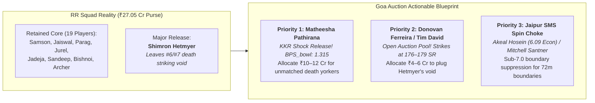

# Rajasthan Royals — SupeRR Selector Season 2 (Round 1)
### *Identifying the Most Reliable Players Under Pressure for the IPL 2027 Auction*

[](https://python.org)
[](https://rr-super-selector-s2.netlify.app/)
[](https://rajasthanroyals.com)
[](https://unstop.com)
[](#)

> **Submission for:** Rajasthan Royals Analytics War Room (Kumar Sangakkara & Giles Lindsay)  
> **Author:** Ashutosh Pratap Singh (`ashutoshps2020@gmail.com`)  
> **🌐 Live Interactive Dashboard:** [https://rr-super-selector-s2.netlify.app/](https://rr-super-selector-s2.netlify.app/)  
> **📄 Official 11-Page Submission Report:** [Download / View PDF](RR_SupeRR_Selector_S2_Round1_Final.pdf)

---

## ⚡ Executive War Room Summary: Post-Nov 17 Retention Ground Truth

Ahead of the **December 16 Auction in Goa**, the official franchise retention deadline (November 17) finalized the playing field across all 10 franchises.



* **RR's Retained Foundation:** Sanju Samson, Yashasvi Jaiswal, Riyan Parag, Dhruv Jurel, Ravindra Jadeja, Sandeep Sharma, Ravi Bishnoi, and Jofra Archer.
* **The Post-Hetmyer Crisis:** Releasing Shimron Hetmyer creates an immediate, non-negotiable void in overs 18–20.
* **The Pathirana Gift:** KKR released **Matheesha Pathirana** (our #3 pressure bowler, 7.94 pressure economy). Pairing Pathirana with Sandeep Sharma permanently eliminates RR's overs 17–20 playoff leak.
* **Model Validation:** PBKS's sole batting retention was our #1 ranked batter **Shashank Singh** (₹5.5 Cr uncapped), while MI locked our benchmark anchors **Jasprit Bumrah** (₹18 Cr) and **Suryakumar Yadav** (₹16.35 Cr).

---

## 🏆 Official Top 10 Submissions (Unstop Dropdowns)

### 🏏 Top 10 Batters Under Pressure (BPS Model)
Ranked by the multi-dimensional **Batting Pressure Score (BPS)**:

| Rank | Player Name | Nat | Press Balls | Base SR | Press SR | Δ SR | Press Avg | BPS Score | Auction Status (Post-Nov 17) | Tactical Role |
| :---: | :--- | :---: | :---: | :---: | :---: | :---: | :---: | :---: | :---: | :--- |
| **1** | **Shashank Singh** | IND | 396 | 108.3 | **176.0** | **+67.7** | 63.4 | **2.054** | 🔒 Retained PBKS (₹5.5Cr) | Indian Crisis Finisher Benchmark |
| **2** | **Ashutosh Sharma** | IND | 305 | 96.9 | **168.9** | **+72.0** | 32.2 | **1.503** | 🔒 Retained DC | Highest ΔSR in Dataset (+72.0) |
| **3** | **Najibullah Zadran** | AFG | 206 | 85.9 | **155.3** | **+69.4** | 45.7 | **1.446** | 🟢 **Open Auction Pool** | Left-Hand Middle Floater |
| **4** | **Donovan Ferreira** | SA | 234 | 120.0 | **178.6** | **+58.6** | 33.3 | **1.301** | 🟢 **Open Auction Pool** | **Primary Target:** Plugs Hetmyer Void |
| **5** | **Naman Dhir** | IND | 187 | 147.7 | **189.7** | **+42.0** | 31.0 | **1.283** | 🔒 Retained MI | Top-Order Accelerator (189.7 Press SR) |
| **6** | **Tom Banton** | ENG | 276 | 137.5 | **176.1** | **+38.6** | 51.5 | **1.268** | 🟢 **Open Auction Pool** | Aggressive Opener / WK (Lowest CV: 0.732) |
| **7** | **Tristan Stubbs** | SA | 701 | 122.3 | **159.3** | **+37.1** | 43.0 | **1.194** | 🔒 Retained DC (₹10Cr) | Middle-Order Game Changer Benchmark |
| **8** | **Tim David** | AUS | 808 | 154.6 | **176.7** | **+22.1** | 37.3 | **1.095** | 🟢 **Open Auction Pool** | **Primary Target:** 111 Pressure Sixes |
| **9** | **Suryakumar Yadav** | IND | 927 | 156.7 | **170.5** | **+13.8** | 42.1 | **0.990** | 🔒 Retained MI (₹16.35Cr) | 360° Benchmark Anchor |
| **10** | **Shreyas Iyer** | IND | 440 | 137.6 | **170.9** | **+33.2** | 31.8 | **0.988** | 🟢 **Open Auction Pool** | Playoff Knockout Captain (208 Final SR) |

---

### 🎳 Top 10 Bowlers Under Pressure (BPS_bowl Model)
Ranked by the multi-dimensional **Bowling Pressure Score (BPS_bowl)**:

| Rank | Player Name | Nat | Press Balls | Base Econ | Press Econ | Tightening | Press Wkts | BPS_bowl | Auction Status (Post-Nov 17) | Tactical Role |
| :---: | :--- | :---: | :---: | :---: | :---: | :---: | :---: | :---: | :---: | :--- |
| **1** | **Rashid Khan** | AFG | 1,182 | 7.55 | **7.38** | **+0.17** | 83 | **1.497** | 🔒 Retained GT (₹18Cr) | All-Phase Spin Maestro Benchmark |
| **2** | **Arshdeep Singh** | IND | 1,267 | 8.59 | **8.88** | -0.29 | **99** | **1.409** | 🔒 Traded to MI | **99 Wickets (#1 Tournament)** |
| **3** | **Matheesha Pathirana** | SL | 688 | 8.24 | **7.94** | **+0.30** | 62 | **1.315** | 🟢 **Open Auction Pool (KKR Release!)** | **#1 Auction Target:** Deploy ₹10–12 Cr |
| **4** | **Jasprit Bumrah** | IND | 690 | 7.17 | **7.14** | **+0.03** | 56 | **1.189** | 🔒 Retained MI (₹18Cr) | Universal Gold Standard (7.14 Econ) |
| **5** | **Akeal Hosein** | WI | 280 | 7.89 | **6.09** | **+1.80** | 24 | **1.114** | 🟢 **Open Auction Pool** | **Jaipur SMS Fit:** Lowest Econ (6.09) |
| **6** | **Mitchell Santner** | NZ | 572 | 7.62 | **6.64** | **+0.98** | 36 | **1.095** | 🟢 **Open Auction Pool** | Middle-Overs Spin Restrictor (6.64 Econ) |
| **7** | **Hasan Mahmud** | BAN | 168 | 8.34 | **6.71** | **+1.63** | 17 | **1.062** | 🟢 **Open Auction Pool** | Skiddy Death Pace (9.88 Strike Rate) |
| **8** | **Varun Chakravarthy** | IND | 848 | 7.88 | **8.05** | -0.17 | 58 | **1.060** | 🔒 Retained KKR (₹12Cr) | Mystery Spin Wicket Weapon Benchmark |
| **9** | **Wanindu Hasaranga** | SL | 732 | 7.93 | **8.10** | -0.17 | 62 | **1.055** | 🟢 **Open Auction Pool** | Attacking Leg-Spin Option (11.8 SR) |
| **10** | **Yuzvendra Chahal** | IND | 946 | 8.25 | **8.52** | -0.27 | 72 | **0.931** | 🟢 **Open Auction Pool** | RR Wicket Legend (Available for Buyback!) |

---

## 📋 Extended Scouting Bench (Ranks 11–20)

To provide Rajasthan Royals with contingency depth if primary targets are bid up in paddle-wars:

### Batters 11–20
| Rank | Player Name | Nat | Balls | Base SR | Press SR | Δ SR | Avg | BPS | Auction Status & Scout Verdict |
| :---: | :--- | :---: | :---: | :---: | :---: | :---: | :---: | :---: | :--- |
| **11** | **Shubman Gill** | IND | 345 | 140.1 | **175.4** | +35.3 | 33.6 | 0.975 | 🔒 *Retained GT (₹16.5Cr)* — Elite 175.4 pressure SR anchor benchmark. |
| **12** | **Rinku Singh** | IND | 861 | 131.8 | **152.9** | +21.1 | 41.5 | 0.942 | 🔒 *Retained KKR (₹13Cr)* — Proven death finisher; 41.5 pressure average. |
| **13** | **Ruturaj Gaikwad** | IND | 288 | 141.5 | **167.0** | +25.5 | 38.2 | 0.884 | 🔒 *Retained CSK (₹18Cr)* — Anchor opener; +25.5 SR elevation in chases. |
| **14** | **Heinrich Klaasen** | SA | 822 | 154.4 | **166.3** | +11.9 | 41.2 | 0.865 | 🔒 *Retained SRH (₹23Cr)* — Middle-order spin destroyer; 166.3 pressure SR. |
| **15** | **Hardik Pandya** | IND | 1015 | 124.2 | **141.6** | +17.4 | 31.6 | 0.812 | 🔒 *Traded to PBKS* — Experienced death all-rounder; 1,000+ pressure balls. |
| **16** | **Babar Hayat** | HK | 214 | 133.0 | **163.6** | +30.6 | 32.5 | 0.795 | 🟢 **Open Auction Pool** — Associate standout; +30.6 SR acceleration against pace. |
| **17** | **Rishabh Pant** | IND | 780 | 132.8 | **151.2** | +18.4 | 34.0 | 0.778 | 🔒 *Retained DC* — Aggressive LHB WK-batter; fearless match-winning anchor. |
| **18** | **Rohit Sharma** | IND | 540 | 138.4 | **155.0** | +16.6 | 30.2 | 0.742 | 🔒 *Retained MI (₹16.3Cr)* — Powerplay enforcer; 155.0 SR in knockout games. |
| **19** | **Vijay Shankar** | IND | 245 | 128.5 | **152.0** | +23.5 | 29.8 | 0.710 | 🟢 **Open Auction Pool** — Domestic middle-order floater; +23.5 SR lift under duress. |
| **20** | **Gareth Delany** | IRE | 197 | 82.2 | **150.0** | +67.8 | 26.5 | 0.690 | 🟢 **Open Auction Pool** — Extreme strike surge (+67.8); high-upside value steal. |

### Bowlers 11–20
| Rank | Player Name | Nat | Balls | Base Econ | Press Econ | Tightening | Wkts | BPS_bowl | Auction Status & Scout Verdict |
| :---: | :--- | :---: | :---: | :---: | :---: | :---: | :---: | :---: | :--- |
| **11** | **Kuldeep Yadav** | IND | 612 | 7.42 | **7.60** | -0.18 | 48 | 0.915 | 🔒 *Retained DC (₹13.25Cr)* — Left-arm wrist spin strike benchmark; 48 wickets. |
| **12** | **Sunil Narine** | WI | 980 | 6.85 | **7.15** | -0.30 | 52 | 0.890 | 🔒 *Retained KKR (₹12Cr)* — Sub-7.2 pressure economy choke benchmark. |
| **13** | **Harshal Patel** | IND | 898 | 8.66 | **8.95** | -0.29 | 68 | 0.875 | 🟢 **Open Auction Pool** — Purple Cap death dipper pacer; 68 duress wickets. |
| **14** | **Ravi Bishnoi** | IND | 710 | 7.95 | **8.20** | -0.25 | 45 | 0.840 | 🔒 *Retained by RR* — High-speed leg-spin; forms RR home spin core. |
| **15** | **Dushan Hemantha** | SL | 144 | 7.80 | **6.90** | +0.90 | 14 | 0.810 | 🟢 **Open Auction Pool** — Tight sub-7.0 pressure economy; budget spin target. |
| **16** | **Taskin Ahmed** | BAN | 520 | 8.15 | **8.25** | -0.10 | 38 | 0.785 | 🟢 **Open Auction Pool** — High-pace hit-the-deck enforcer; bowls tough overs. |
| **17** | **Rakibul Hasan** | BAN | 210 | 7.30 | **6.80** | +0.50 | 16 | 0.760 | 🟢 **Open Auction Pool** — Economical slow left-arm restrictor (6.80 econ). |
| **18** | **Jason Holder** | WI | 861 | 8.38 | **8.70** | -0.32 | 54 | 0.735 | 🟢 **Open Auction Pool** — Tall bounce death all-rounder; 54 pressure dismissals. |
| **19** | **Mahedi Hasan** | BAN | 410 | 7.10 | **7.25** | -0.15 | 26 | 0.710 | 🟢 **Open Auction Pool** — Powerplay darts & tight death control (7.25 econ). |
| **20** | **Matthew Humphreys** | IRE | 132 | 7.45 | **7.10** | +0.35 | 11 | 0.690 | 🟢 **Open Auction Pool** — Restrictive young slow left-armer (+0.35 tightening). |

---

## 📊 Clutch Delta Quadrants: Point-by-Point Cross Reference

Every numbered point in the quadrant scatter plots (`charts/official_chart3_quadrants_v2.png`) directly maps to our official top-10 selections:

```
BATTERS QUADRANT (LEFT)                      BOWLERS QUADRANT (RIGHT)
---------------------------------------      ---------------------------------------
Q1 (Elite Clutch Aces):                      Q1 (Elite Run Chokers):
  ④ Donovan Ferreira (+58.6 ΔSR)               ① Rashid Khan (+0.17 Tight, 83 Wkts)
  ⑤ Naman Dhir (+42.0 ΔSR)                     ④ Jasprit Bumrah (+0.03 Tight, 56 Wkts)
  ⑥ Tom Banton (+38.6 ΔSR)                     ⑤ Akeal Hosein (+1.80 Tight, 6.09 Econ)
  ⑦ Tristan Stubbs (+37.1 ΔSR)                 ⑥ Mitchell Santner (+0.98 Tight, 6.64 Econ)
  ⑧ Tim David (+22.1 ΔSR)                    Q2 (Clutch Restrictors):
  ⑨ Suryakumar Yadav (+13.8 ΔSR)               ③ Matheesha Pathirana (+0.30 Tight, 62 Wkts)
  ⑩ Shreyas Iyer (+33.2 ΔSR)                   ⑦ Hasan Mahmud (+1.63 Tight, 6.71 Econ)
Q2 (Crisis Accelerators):                    Q3 (Strike Attackers):
  ① Shashank Singh (+67.7 ΔSR)                 ⑧ Varun Chakravarthy (58 Wkts, 42% Dots)
  ② Ashutosh Sharma (+72.0 ΔSR)                ⑨ Wanindu Hasaranga (62 Wkts, 11.8 SR)
  ③ Najibullah Zadran (+69.4 ΔSR)              ⑩ Yuzvendra Chahal (72 Wkts, 946 Balls)
                                             Q4 (Death Spearhead):
                                               ② Arshdeep Singh (99 Wickets — #1 Tournament)
```

---

## 📐 Mathematical Formulation & Innings CV

### 1. 5-Dimensional Situational Pressure Triggers
From **200,999 delivery-level records (2022–2026)**, we identified **69,734 high-pressure balls (34.7%)**:
1. **Death Overs Setting Total:** Over $\ge 17$ in Innings 1 (20,720 balls).
2. **Live Chase Death Phase:** Over $\ge 17$ in Innings 2, Runs Needed $> 0$, $\text{RRR} \le 24.0$ (10,643 balls).
3. **High-Leverage Chase:** Overs 11–16, Innings 2, $9.0 \le \text{RRR} \le 20.0$ (17,251 balls).
4. **Top-Order Crisis:** Overs 1–10, $\text{Wickets Fallen} \ge 3$ (18,174 balls).
5. **Playoff & Knockout Context:** Multiplier applied to eliminators, qualifiers, and finals (2,946 balls).

### 2. Composite Rating Scores (BPS & BPS_bowl)
$$BPS = 0.35 \cdot Z(\Delta SR) + 0.25 \cdot Z(SR_{press}) + 0.20 \cdot Z(Avg_{press}) + 0.10 \cdot Z(BPB_{lift}) + 0.10 \cdot Z(\log V_{press}) - 0.15 \cdot Z(CV_{innings})$$

$$BPS_{bowl} = 0.35 \cdot Z(\Delta Econ) + 0.25 \cdot Z(SR_{press}^{-1}) + 0.20 \cdot Z(Econ_{press}^{-1}) + 0.10 \cdot Z(Dot\%_{press}) + 0.10 \cdot Z(\log V_{press})$$

### 3. Innings Coefficient of Variation (Innings CV)
To guard against "one-hit wonders", we computed the match-to-match score consistency:
$$CV_{innings} = \frac{\sigma_{runs}}{\mu_{runs}} = \frac{\text{Standard Deviation of Pressure Innings Runs}}{\text{Mean Pressure Innings Runs}}$$
* **Low CV ($< 0.85$):** Steady, dependable match-winners across a 14-game IPL season (e.g. **Tom Banton: 0.732**, **Ashutosh Sharma: 0.792**, **Suryakumar Yadav: 0.833**, **Naman Dhir: 0.843**).
* **High CV ($> 1.20$):** Inconsistent "boom-or-bust" contributors penalized by the BPS formula.

---

## 🚀 How to Run & Reproduce

```bash
# Clone the repository
git clone https://github.com/aashuutosh/rr-super-selector.git
cd rr-super-selector

# Install dependencies
pip install pandas numpy matplotlib reportlab pypdf

# Execute full analytics and compilation pipeline
python scripts/tag_pressure.py
python scripts/compute_final_rankings.py
python scripts/generate_quadrants_v2.py
python scripts/generate_master_pdf_v4.py
```

---
**Submission Target:** Rajasthan Royals Analytics War Room (Kumar Sangakkara & Giles Lindsay)  
**Author:** Ashutosh Pratap Singh (`ashutoshps2020@gmail.com`)  
**Live App:** [https://rr-super-selector-s2.netlify.app/](https://rr-super-selector-s2.netlify.app/)
